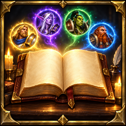

<p align="center">
  
</p>

<h1 align="center">AltoLite</h1>

<p align="center">
  <b>Every alt at a glance, without the bloat.</b><br>
  A small, fast alt dashboard for World of Warcraft Retail.
</p>

<p align="center">
  <a href="https://www.curseforge.com/wow/addons/altolite">CurseForge</a> ·
  <a href="https://discord.gg/YxFRuEPSxZ">Discord</a> ·
  <a href="https://ko-fi.com/korivash">Ko-fi</a>
</p>

---

## What it does

AltoLite keeps a snapshot of every character on your account and shows them all in one window, on any character. Log into each character once and it is saved; from then on it updates whenever you play it.

## Features

### Overview
- Class icon, class-colored name and realm
- Level and equipped item level, colored by tier against your best character
- Gold on every character, with an account total in the header

### Mythic+
- Mythic+ score with rarity colors
- The keystone each character is holding (for example `+12 Dungeon Name`)
- Best key per dungeon this season

### Great Vault
- Raid, dungeon and world rows with progress bars for each character
- Marked as out of date after the weekly reset instead of shown as current

### Weekly
- A per-character checklist for the week: vault progress, keystone run and the weekly quests you choose to track

### Currencies
- Track any currencies you pick, one column each with its icon

### Lockouts
- Raid lockouts with boss progress; expired lockouts are hidden

### Details for every character
- Click a character to expand: item level per gear slot with the lowest slots highlighted, professions, renown, played time, rested XP and when you last played them
- Hover any character for a full tooltip

### Built for daily use
- Header bar with total gold, character count, best item level, best Mythic+ score and a live weekly reset countdown
- Your current character is pinned to the top
- Search box, realm filter and sortable columns
- Minimap button and Addon Compartment entry
- Window scale, size and position are remembered; ESC closes it

## Make it yours

Open `/alto options` and go to **Appearance**:
- Color wheel for the accent, window background, header, row stripes, row hover, text and border
- Background opacity from solid down to fully transparent
- Border style, font size, row height and window scale
- Class-colored names, compact mode, show or hide the header summary
- Presets: Default Dark, Transparent, Midnight Purple, Light and Class Color, plus a reset button

Every change applies instantly, no reload needed.

## Performance

AltoLite is designed to stay out of the way:
- Nothing runs while the window is closed except event handlers
- No work at login beyond saving your current character
- The window and settings are only built the first time you open them
- Rows are reused instead of recreated, so long alt lists stay smooth
- Saved data is versioned and migrated automatically between releases

## Commands

| Command | Action |
| --- | --- |
| `/alto` | Open or close the window |
| `/alto options` | Open the settings (currencies, columns, minimap button, scale) |

You can also left-click the minimap button to toggle the window, or right-click it for settings.

## Installation

**CurseForge app (recommended):** search for AltoLite and click Install.

**Manual:** download the latest file from [CurseForge](https://www.curseforge.com/wow/addons/altolite), then extract the `AltoLite` folder into:

```
World of Warcraft\_retail_\Interface\AddOns\
```

Then restart the game or type `/reload`.

## FAQ

**Why do I only see one character?**
WoW only lets an addon read the character you are logged into. Log into each alt once and it will appear on every character.

**Is my data shared anywhere?**
No. Everything is stored locally in your WoW saved variables.

**I found a bug or have an idea.**
Join the [Discord](https://discord.gg/YxFRuEPSxZ) and let us know.

## Support

If you enjoy AltoLite, you can support development on [Ko-fi](https://ko-fi.com/korivash).
